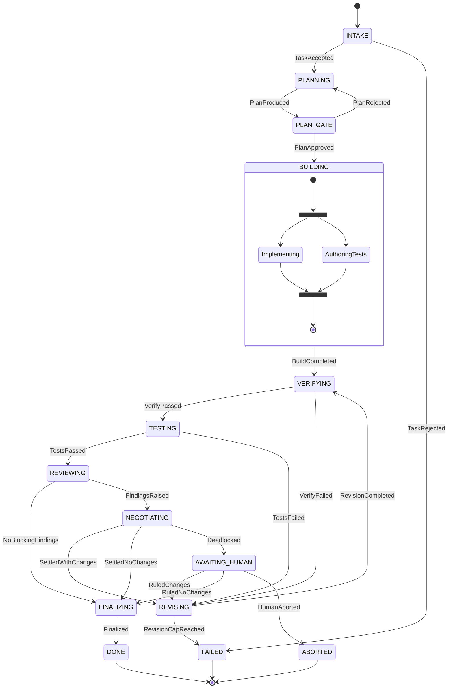

# Multistep Agent: Engineering Plan

> Status: **M0–M2, M4, M5 and M7 complete; M3 and M6 await a live recording** · Owner: sairambabu979-sys · Last updated: 2026-11-07
>
> This document is the build contract. Every milestone below has exit criteria a CI job can check.
> If a section here and the code disagree later, one of them is a bug.

---

## 0. Read this first: what this plan assumes, and where it could be wrong

| # | Assumption | Confidence | If wrong |
|---|---|---|---|
| A1 | The agent is a **coding agent**: given a task and a git repository, it produces a change that has been planned, implemented, tested, and reviewed. | Likely | The Reviewer and Tester roles change shape. The core state machine, journal and preferences design still apply. |
| A2 | "Code negotiator" means a **structured, bounded negotiation between the author agent and the reviewer agent**, not a free-form chat between them. | Likely | If you meant a human-in-the-loop negotiator, the `AWAITING_HUMAN` path becomes the main path rather than the exception. |
| A3 | "State machine" refers to two things: the orchestrator *is* a state machine, and the state machine *is tested as a first-class artifact* (property-based and model-based tests). | Likely | — |
| A4 | Python 3.12+, Anthropic Python SDK, models called through the Messages API. | Decision, see §14 | TypeScript works too. We would lose Hypothesis's `RuleBasedStateMachine`, which is the best available tool for A3. |
| A5 | Local-first: runs on a developer machine or in CI, against a local clone. It does not push branches or open PRs unless explicitly enabled. | Certain (by design) | Opening PRs is an outward-facing action. It is behind a flag and comes in a later milestone. |

**Non-goals for v1:** web UI, multi-repo changes, auto-merge, running untrusted repos without a container sandbox, and fine-tuning.

**What "world-class" means in this plan.** More moving parts is not the goal. Each item below is something you can verify:

1. **The core is pure.** The state machine is a pure function `(State, Event) -> (State, [Effect])`. It does no I/O, reads no clock, and uses no randomness, so it can be tested exhaustively without a model.
2. **Every run can be replayed.** Each run is an append-only event log, so crashes resume, past runs replay byte-for-byte, and every decision can be audited.
3. **Disagreements about correctness are settled by running code, not by debate.** When reviewer and author disagree about correctness, a test is written and run, and its result decides the dispute.
4. **Every component must earn its place on an eval.** If the ablation in §11 shows the reviewer does not raise quality enough to justify its cost, the reviewer gets cut.
5. **Architecture rules are enforced by CI, not by convention.** Layering is checked by `import-linter`, types by `mypy --strict`, and the state diagram in the docs is generated from the code.

---

## 1. System overview

```
                         ┌──────────────────────────────────────────────┐
  task + repo  ───────▶  │  Orchestrator (pure FSM)                      │
                         │  transition(state, event) -> (state, effects) │
                         └───────────────┬──────────────────────────────┘
                                         │ effects            ▲ events
                                         ▼                    │
                         ┌──────────────────────────────────────────────┐
                         │  Interpreter (imperative shell)               │
                         │  executes effects · appends to Journal        │
                         └──┬──────────┬───────────┬───────────┬────────┘
                            │          │           │           │
                     ┌──────▼───┐ ┌────▼─────┐ ┌───▼──────┐ ┌──▼──────────┐
                     │ Agents   │ │ Sandbox  │ │ Journal  │ │ Preferences │
                     │ Planner  │ │ worktree │ │ SQLite   │ │ Skill       │
                     │ Coder    │ │ + tools  │ │ events   │ │ layered     │
                     │ Tester   │ │ + caps   │ │ snapshots│ │ store       │
                     │ Reviewer │ └──────────┘ └──────────┘ └─────────────┘
                     │ Arbiter  │
                     └────┬─────┘
                          ▼
                   LLM Gateway (Anthropic SDK · retries · budget · cassettes)
```

**Architectural style:** hexagonal (ports and adapters) around a functional core. The `core` package imports nothing from `runtime`, `agents`, or `anthropic`. `import-linter` enforces this in CI.

---

## 2. The state machine

### 2.1 Phases

| Phase | Responsibility | Exits to |
|---|---|---|
| `INTAKE` | Validate the task, record the **base tree hash**, resolve preferences, compute the budget. | `PLANNING`, `FAILED` |
| `PLANNING` | The Planner produces a `Plan`: steps, **acceptance criteria**, files expected to change, risks. | `PLAN_GATE` |
| `PLAN_GATE` | Auto-approve, or wait for a human (config `plan_gate: auto\|human`). | `BUILDING`, `PLANNING` (with feedback, ≤ 2 replans) |
| `BUILDING` | **Two parallel regions:** the Coder implements and the Tester writes acceptance tests *from the plan, blind to the implementation*. They join when both finish. | `VERIFYING` |
| `VERIFYING` | Deterministic checks only: format, lint, typecheck, machine-checkable preferences, existing unit tests. No LLM. | `TESTING`, `REVISING` |
| `TESTING` | Run the full suite. Run **fail-before / pass-after** against the base tree. Rerun failures to detect flakes. The Tester triages any failures. | `REVIEWING`, `REVISING` |
| `REVIEWING` | The Reviewer produces a `Review`, a set of findings with evidence, for the current head tree. | `NEGOTIATING`, `FINALIZING` |
| `NEGOTIATING` | Bounded rounds of the protocol in §4, including executable arbitration. | `REVISING`, `FINALIZING`, `AWAITING_HUMAN` |
| `REVISING` | The owner (Coder or Tester) applies accepted findings or fixes triaged failures. | `VERIFYING`, `FAILED` (revision cap) |
| `AWAITING_HUMAN` | A resumable pause holding a structured question. | `REVISING`, `FINALIZING`, `ABORTED` |
| `FINALIZING` | Produce the commit or patch, the run report, and preference proposals. | `DONE` |
| `DONE` / `FAILED` / `ABORTED` | Terminal states. Once entered, they never change. | — |

**Global transitions** (handled in every non-terminal phase, and enforced by a test):
`BudgetExhausted → FAILED`, `Cancelled → ABORTED`, `FatalError → FAILED`. Each of these still writes a partial run report.

### 2.2 Diagram

The real diagram is generated from the transition table (`msa fsm diagram`), and CI fails if `docs/fsm.md` is out of date. The version below is hand-written for this plan.



**Why tests run before review.** Reviewer tokens are never spent on a red build. Running tests first also gives the reviewer the test results as evidence.

### 2.3 The core contract (sketch)

```python
# src/msa/core/machine.py  (no I/O, no clock, no randomness)

@dataclass(frozen=True, slots=True)
class Step:
    state: RunState
    effects: tuple[Effect, ...]

def transition(state: RunState, event: Event) -> Step:
    """Total function: every (phase, event) pair is handled, either explicitly
    or by the global handler that rejects it as IllegalTransition. Exhaustiveness
    is checked by mypy via `assert_never` on the Event union."""
```

- `RunState` is a frozen Pydantic model. It holds phase, head tree hash, plan, open findings, revision count, budget ledger, and negotiation round.
- `Event` and `Effect` are **discriminated unions**. Each carries a `v` schema version, and old journals load through *upcasters*.
- Time and IDs come *in* through events, for example `TaskSubmitted(at=..., run_id=...)`. The core never generates them.
- **Evidence is bound to the code it checked.** `VerifyPassed`, `TestsPassed`, and every `Finding` carry the `tree_hash` they were produced against. Evidence for a stale tree is rejected by the transition function, so "tests passed on old code" cannot happen.

### 2.4 Invariants (each one is a Hypothesis property)

1. **Terminal absorption.** No event moves a run out of `DONE`, `FAILED`, or `ABORTED`.
2. **Finalization gate.** `FINALIZING` is reachable only if, for the *current* `head_tree`: verify passed, tests passed, fail-before/pass-after held, and there are zero open `blocker` or `major` findings.
3. **Bounded work.** `revisions ≤ max_revisions`, `negotiation_round ≤ max_rounds`, and `replans ≤ 2`.
4. **Negotiation progress.** In every round, the count of open findings strictly decreases, or the round emits `Deadlocked`. The system never loops silently.
5. **Budget safety.** For every live run, `spent + reserved ≤ limit`. Each spending effect is issued with a *reservation*: a slice of the remaining budget it must not exceed. Concurrent effects get disjoint slices, so parallel regions cannot overspend together. Reported overspend is recorded truthfully and ends the run.
6. **Replay determinism.** `fold(transition, journal.events) == live_state` for every run in the test corpus.
7. **Liveness.** Statically, every live phase can reach `DONE` through rules alone (global escapes don't count). Exhaustively, every *reachable state* can still reach `DONE` (EF DONE), checked by model checking at the default limits. This check found a real bug in M1: at the revision cap, a run that had already accepted a change kept negotiating, and paged a human, toward an outcome that was already decided. It now fails fast.
8. **No dead entries.** Every phase is reachable from `INTAKE`.
9. **Never stuck.** A live run always has at least one pending effect, so it can never wait on nothing.

All state-level invariants run on **every transition in production**, not only in tests. A violation raises `InvariantViolation` at the step that caused it.

---

## 3. Agents

Every agent is a **role** with a fixed system prompt, a fixed tool set, a **capability set** enforced by the harness, and a **typed output** (a Pydantic model validated through structured outputs).

| Role | Input | Output schema | Tools | Write capability | Effort (initial) |
|---|---|---|---|---|---|
| **Planner** | task, repo map, preferences | `Plan` | read, search | none | `high` |
| **Coder** | plan, preferences, revision requests | `ImplementationSummary` | read, search, edit, run (allowlist) | `src/**` and anything not owned by Tester | `xhigh` |
| **Tester** | plan + acceptance criteria (**not** the Coder's diff during BUILDING) | `TestSuiteSummary`, `TestTriage` | read, search, edit, run | `tests/acceptance/**`, `tests/repro/**` | `high` |
| **Reviewer** | diff, plan, test results, preferences (**not** the Coder's reasoning) | `Review` | read, search, git_diff | none | `high` |
| **Arbiter** | disputed finding + both positions + executable evidence | `Ruling` | none | none | `high` (`max` on escalation) |

> The effort levels are starting points [Guessing]. The eval harness (§11) picks the final values per role.

**Path ownership is enforced in the tool layer, not in the prompt.** If the Coder calls `edit("tests/acceptance/test_x.py")`, the call returns a `CapabilityDenied` tool error, however the model was persuaded to try. This guarantees two things:
- the Coder cannot weaken the Tester's tests to make them pass, and
- prompt injection from repo content cannot escalate privileges.

Because ownership splits the paths, the two BUILDING regions run in **separate git worktrees** and merge without conflicts by construction.

### 3.1 Agent runtime (one loop per role invocation)

- We own the loop on the **Messages API** (manual loop rather than the SDK tool runner) because the journal has to checkpoint every turn. The reasons are recorded in ADR-002.
- **Model:** `claude-opus-5-5` for every role in v1. Only `output_config.effort` varies by role. We stay on one model because caches are model-scoped and a multi-model cascade gives up cache reuse. We move off a single model only if the evals show a cheaper model holds quality on a specific role.
- **Thinking:** adaptive. It cannot be disabled on Opus 5.5, and that is fine.
- **Structured final answer:** `output_config.format` (JSON schema generated from the Pydantic model) together with `strict: true` tools. We never use forced `tool_choice`: `any` and `tool` return a 400 on this model.
- **Transcripts are append-only, enforced by type.** The `Transcript` type has `append()` and nothing else. Mid-run instructions, such as a preference added during the run, go in as appended `role: "system"` messages. The top-level `system` prompt and the tool list are frozen for the life of the invocation. This keeps the prompt cache warm and satisfies the API's history-editing check on thinking blocks. Every request sends `thinking.block_binding.prefix_mismatch_behavior: "error"` under beta `thinking-binding-controls-2026-08-01`, so any accidental history edit fails loudly, and the recorded `msa llm ping` cassette proves it against the real API (ADR-008).
- **Prompt caching:** tools are serialized sorted by name, the system prompt is byte-stable, and preferences are rendered in a deterministic order. Every live run records `cache_read_input_tokens`, and the eval report flags a hit rate below the threshold.
- **Streaming:** always `messages.stream(...)` + `get_final_message()`, with `max_tokens` set to 64k.
- **Stop reasons are handled exhaustively:** `end_turn`, `tool_use`, `max_tokens`, `pause_turn`, and `refusal`. On `refusal` the request uses server-side `fallbacks: "default"` (beta `server-side-fallback-2026-07-01`). If the whole chain refuses, the gateway emits `AgentRefused(category)`, which leads to `FAILED` with a clear report.
- **Task budgets:** each invocation passes `output_config.task_budget` (beta `task-budgets-2026-03-13`) so the model paces itself. The harness ledger enforces the hard limit separately.
- **Errors:** errors are classified most specific first. Before a response starts, the SDK retries rate limits, 5xx and connection errors, with backoff and `retry-after`. After the stream starts, the gateway retries what the SDK cannot: mid-stream `error` events, transport failures while reading the body, and cut-off streams. Everything else, including 4xx, is a non-retryable `AgentFailed`. Retries happen inside one effect and do not cause state transitions (ADR-008).

### 3.2 Tool surface

| Tool | Notes |
|---|---|
| `read_file(path, start_line?, end_line?)` | Returns numbered lines plus the whole file's `content_hash`. Paths are resolved once, confined to the worktree, then opened component by component without following symlinks, so a symlink swapped in mid-call is refused (ADR-009). |
| `search(pattern, glob?)` | ripgrep: linear-time regexes, `.gitignore`-aware, never follows symlinks, results sorted so replays stay byte-identical. Read-only, so it runs in parallel. |
| `edit(path, old, new, expected_hash)` | **Staleness check:** rejected if the file changed since it was read. The capability check runs first, on the *resolved* path. Atomic: temp file, fsync, rename. |
| `create_file(path, content)` | Capability-checked on the resolved path. Atomic, and never replaces an existing file. |
| `run(command, paths, keyword?)` | `command` comes from an **allowlist** (`pytest`, `ruff_check`, `ruff_format_check`, `mypy`) with typed arguments. The tool never accepts a raw shell string. It runs with a timeout, an output cap, rlimits, a scrubbed environment, and network steered to a dead proxy. |
| `git_diff(base?)` | Read-only. Repository config cannot run programs: fsmonitor, hooks, external diff and textconv are off. |

Read-only calls run concurrently. Writes run serially. All `tool_result`s for one turn go back in a single user message.

---

## 4. Reviewer ⇄ Author negotiation protocol

This is the hardest part of the system, and the part most likely to fail quietly. When two LLMs negotiate, the conversation tends to fall into one of three patterns:

- **sycophantic collapse:** the author accepts everything,
- **rubber-stamping:** the reviewer approves everything, or
- **goalpost drift:** new findings keep appearing every round.

The protocol is designed to make each of these structurally impossible, or at least easy to measure.

### 4.1 Data model

```python
class Finding(BaseModel):
    id: FindingId
    tree_hash: TreeHash                 # evidence binding
    severity: Literal["blocker", "major", "minor", "nit"]
    kind: Literal["correctness", "security", "performance", "design", "style", "preference"]
    location: CodeLocation              # file + line range, must intersect the diff
    claim: str
    evidence: str                       # quoted code, failing input, spec reference
    suggested_fix: str | None
    preference_ref: PreferenceId | None # required when kind == "preference"
    confidence: float                   # reviewer's own estimate, calibrated in evals

class AuthorMove(BaseModel):
    finding_id: FindingId
    action: Literal["accept", "rebut", "counter", "defer"]
    rationale: str                      # required for every action, including accept
    evidence: str | None                # required for rebut

class ReviewerMove(BaseModel):
    finding_id: FindingId
    action: Literal["withdraw", "maintain", "amend"]
    rationale: str
```

### 4.2 Rules

1. **Scope.** A finding's `location` must intersect the diff. In round N > 1, a *new* finding is admissible only if it falls on lines changed by the latest revision. This stops goalpost drift by construction.
2. **One round:** reviewer → author moves → reviewer replies. A finding closes when it is accepted, withdrawn, or deferred (deferred findings become follow-up items in the report).
3. **Progress.** The open set must strictly shrink each round (invariant 4). After `max_rounds` (default 3), anything still open goes to arbitration.
4. **Arbitration ladder**, cheapest and most objective first:
   - **Correctness or security disputes are settled by execution.** The Tester writes a **repro test** for the finding's claim. If the test fails on the head tree, the finding is upheld. If it passes, the finding is dismissed. If the test cannot be written, the dispute goes to the next rung. The repro test is kept as a regression test.
   - **Preference disputes are settled by the preference store.** If an applicable preference exists, it wins. A `hard` preference is upheld as a blocker. A `soft` one is downgraded to a nit.
   - **Style disputes not covered by any preference:** the author wins and the finding is dropped. Taste is not a merge blocker.
   - **Remaining `blocker`/`major` disputes:** the Arbiter role at `max` effort issues a `Ruling`. If `escalation: human` is configured, the dispute goes to `AWAITING_HUMAN` instead.
5. **Anti-sycophancy measures:**
   - The Reviewer never sees the Coder's reasoning, only the artifacts.
   - Every accept requires a rationale.
   - The eval report tracks the **acceptance rate** and the **withdrawal rate**. If the author accepts more than 95% of findings, or the reviewer withdraws more than 80%, the run is flagged as a degenerate negotiation.
6. **Nits never block.** They are reported, and the Coder can batch-apply them during `REVISING` when budget allows.

---

## 5. Preferences skill

### 5.1 What it is

A preference is a versioned, scoped rule describing how *you* want code written. All agents consume preferences, and preferences decide style disputes.

The skill is packaged in the standard **Agent Skill** layout (`skills/preferences/SKILL.md` plus resources), so the same skill also works in Claude Code. In this harness, the resolved subset is injected directly, because preferences are always relevant and do not need progressive disclosure.

### 5.2 Schema

```yaml
# .msa/preferences.yaml  (repo layer)
version: 1
preferences:
  - id: py.errors.no-bare-except
    scope: { language: python, paths: ["src/**"] }
    rule: "Never use bare `except:`; catch the narrowest exception type."
    rationale: "Bare excepts swallow KeyboardInterrupt and hide bugs."
    enforcement: hard            # hard → blocker | soft → nit | info → context only
    check: { kind: ruff, rule: E722 }  # optional: machine-checkable → enforced in VERIFYING
    examples:
      good: "except FileNotFoundError:"
      bad:  "except:"
    source: user                 # user | learned (approved)
```

### 5.3 Resolution

The layers, from lowest to highest precedence:

`built-in defaults < user global (~/.config/msa/preferences.yaml) < repo (.msa/preferences.yaml) < run overrides (--pref)`

- The merge is a right-biased map union keyed by `id`, then by field: a layer entry may set only the fields it changes, such as `--pref <id>=off`. It is associative, has an identity and is idempotent, and all three laws are property-tested (ADR-010). `enforcement: off` switches an inherited preference off without breaking the laws.
- **Conflict detection at load time.** If two `hard` preferences with overlapping scopes contradict each other (declared through `conflicts_with`), the run fails in `INTAKE` with a precise error. Overlap is decided soundly: it may ask you to narrow a scope that doesn't truly overlap, but it never misses one that does.
- **Scope selection** is by language and path glob, matched against the plan's `files_expected`. Selection happens once per run, so the rendered block stays byte-stable for caching.

### 5.4 Enforcement split

| Preference has… | Enforced by | Cost |
|---|---|---|
| a `check` (`ruff` rule, or a `regex` that must not occur; AST visitors and custom checkers later) | `VERIFYING`, deterministically (`msa prefs check` runs the same checks by hand) | zero tokens |
| no `check` | Coder (as guidance) and Reviewer (as `kind: preference` findings) | LLM tokens |

**Design rule:** if a linter can enforce a preference, no LLM is used for it. `msa prefs lint` warns when a `hard` preference has no `check` and could have one.

### 5.5 Learning, which always needs your approval

When a dispute is decided by a human ruling, or the same `style` finding is dismissed three or more times across runs, `FINALIZING` writes a **preference proposal** to `.msa/proposals/`. Proposals are applied only after `msa prefs review` and explicit approval. Preferences never change silently.

### 5.6 CLI

`msa prefs list | show <id> | add | explain <file[:line]> | lint | review | diff-layers | check [paths]`

---

## 6. Tester and integration testing

### 6.1 What the Tester does at runtime

1. **Writes acceptance tests without seeing the implementation.** During `BUILDING`, the Tester sees the plan's acceptance criteria, not the Coder's diff. This keeps the tests from inheriting the implementation's mistakes.
2. **Checks fail-before / pass-after.** The new acceptance tests must **fail on the base tree** and **pass on the head tree**. This runs in a temporary worktree at the base. A test that passes on the base tree proves nothing and is rejected.
3. **Detects flakes.** Each failing test is rerun up to `k=3` times in isolation. A test with mixed results is classified `flaky` and reported. It is **never** quarantined or skipped to get a green run.
4. **Triages failures** into `TestTriage { kind: impl_bug | test_bug | flaky | env, test_id, diagnosis, owner }`, which routes `REVISING` to the right owner.
5. **Has a guard against weakened tests.** When the Tester revises its own test, the harness diffs assertions by AST. Removing or loosening an assertion requires a Reviewer finding to approve the change.

### 6.2 Testing the agent itself

| Layer | What it proves | Tooling | When |
|---|---|---|---|
| **Unit** | Tools, path confinement, preference merge, cost ledger, prompt rendering | pytest | every push |
| **Property** | FSM invariants (§2.4), preference merge laws, edit/apply round-trips, journal encode/decode | Hypothesis | every push |
| **Model-based** | `RuleBasedStateMachine` sends random legal and illegal event sequences to `transition` and checks every invariant after each step | Hypothesis stateful | every push |
| **Model check** | BFS over *every* reachable state at the production default limits (about 81k states across 4 configurations). Checks: no stuck states, EF DONE, every declared edge exercised, every rule-driven outcome reachable. | `tests/support/explorer.py` | every push |
| **Static FSM** | Reachability, liveness, global-event coverage, diagram up to date | graph checks over the table | every push |
| **Contract** | Every output schema is strict-compatible, every prompt renders byte-stable, and transcripts are append-only (prefix-extension check) | pytest | every push |
| **Integration** | The full pipeline on fixture repos with a **scripted FakeLLM** and a **real sandbox** (see the scenarios below) | pytest, subprocess | every push |
| **Replay** | Recorded real-model runs (cassettes keyed by a canonical request hash) replay with no network | pytest | every push |
| **Chaos** | A forked child `SIGKILL`s itself at a random boundary (effect started, transition computed but not durable, event durable) one to three times per run. Each run must resume to *exactly* the uninterrupted final state, and no journaled effect may execute again. | pytest, fork + SIGKILL | every push (25 trials), nightly (100) |
| **Mutation** | Every mutant of `core/` must be killed by the fast suites (zero-survivor budget) | `mutmut`, `scripts/mutation_gate.py` | nightly, `make mutation` |
| **Live eval** | The real model on the task corpus, with ablations (§11) | `msa eval` | nightly / manual, budget-capped |

**Integration scenarios** (each is a named test with a fixture repo and a FakeLLM script):

| # | Scenario | Asserts |
|---|---|---|
| I-01 | Happy path | `DONE`. Report generated. Exact event sequence matches a golden file. |
| I-02 | Lint fails, then fixed | `VERIFYING → REVISING → VERIFYING → TESTING` |
| I-03 | Acceptance test passes on base | Rejected by fail-before check. Tester revises. |
| I-04 | Flaky test | Classified `flaky`, never skipped, surfaced in the report |
| I-05 | Blocker accepted by author | One negotiation round, then `REVISING` |
| I-06 | Rebuttal with evidence, reviewer withdraws | `SettledNoChanges → FINALIZING` |
| I-07 | Disputed correctness | A repro test is written and run, and the ruling follows its result |
| I-08 | Deadlock on design | `AWAITING_HUMAN`. Resume with ruling. Completes. |
| I-09 | New finding outside the latest revision's lines in round 2 | Rejected as inadmissible |
| I-10 | Budget exhausted mid-negotiation | `FAILED` with a partial report. Ledger never exceeded. |
| I-11 | Crash during `BUILDING`, then `msa resume` | Same final state. No duplicate LLM spend (responses replayed from the journal). |
| I-12 | Coder tries to edit a Tester-owned file | `CapabilityDenied` tool error. Run continues. |
| I-13 | Tool path escape (`../../etc/passwd`, symlink) | Rejected. Event logged. |
| I-14 | Model refusal | `AgentRefused` leads to `FAILED` with the category in the report |
| I-15 | Stale evidence (tests passed for an old tree) | Transition rejected, so it cannot reach `FINALIZING` |
| I-16 | Conflicting `hard` preferences | Fails in `INTAKE` with a precise message |

---

## 7. Durability: journal, resume, replay

- **Storage:** SQLite (WAL, `synchronous=FULL`) at `.msa/runs.db`. Tables:
  - `runs`: id, environment (how to rebuild executors on resume), head seq, phase, outcome;
  - `events(run_id, seq, kind, v, payload, recorded_at)`;
  - `snapshots(run_id, seq, v, state)`, written every 50 events and at the end of every run.
- **The commit point** is the event append, a compare-and-set on the run's head seq inside `BEGIN IMMEDIATE`. The transition is computed first (it is pure), then the event is appended, then new effects are launched. See [ADR-007](adr/007-commit-point-and-crash-semantics.md).
- **Crash semantics:**
  - An effect whose completion is journaled is **never executed again**, so its tokens are never paid for twice.
  - An effect that was in flight at the crash runs again on resume (at-least-once). Executors get the deterministic effect id as an idempotency key.
  - An interrupted process (crash or Ctrl-C) leaves the run live and resumable. `msa cancel` journals a terminal outcome, and a process still driving the run sees `JournalConflict` and adopts it.
- **Time** is stamped by the interpreter at commit, so it is monotonic even when concurrent effects finish out of order. Simulations use a logical clock, which is what makes crash recovery reproducible bit for bit.
- **Executor failures** (exception, malformed answer, answer the core rejects) become `AgentFailed` or `EffectFailed`. The run fails fast with a reason, never stalls.
- **Schema evolution:** every event row carries `v`, and upcasters migrate old payloads on load. Snapshots of another state version are ignored and rebuilt from events. A journal from a newer `msa` is refused, not misread.
- **Snapshots are caches:** `load` trusts the newest one, and `verify` re-folds all of history and audits every snapshot.
- **Commands:**
  - `msa simulate`: a full run against deterministic stub executors.
  - `msa runs`: list journaled runs.
  - `msa resume <run>`: continue from snapshot plus tail.
  - `msa inspect <run> [--at <seq>] [--json]`: time travel.
  - `msa replay <run>`: re-fold the whole journal and verify every snapshot.
  - `msa cancel <run>`: journal a terminal cancellation.

---

## 8. Sandbox and security

| Threat | Control |
|---|---|
| Destructive or unexpected commands | Command allowlist with typed arguments. No raw shell. Timeouts, an output cap, and `RLIMIT_*` limits. |
| Filesystem escape | Paths are resolved once and confined, then opened by descriptor without following symlinks, so the check and the use cannot be raced apart. Writes are atomic renames, which also break hard links. Fuzzed and race-tested (ADR-009). |
| Network exfiltration | `ContainerSandbox` runs with `--network none`. `LocalSandbox` only steers HTTP clients to a dead proxy and sets package tools offline: that stops well-behaved clients, not a hostile one, so it is no boundary (ADR-009). |
| Secrets in prompts | The environment is scrubbed before any subprocess runs. A secret scanner runs over outgoing prompt payloads in debug builds. |
| Prompt injection from repo content | Capabilities are enforced by the harness (§3). Tool results are wrapped as data. The agent cannot change its own permissions, budget, or phase. |
| Untrusted repos | The `SandboxPort` has two adapters: `LocalWorktreeSandbox` (default, trusted repos) and `ContainerSandbox` (Docker or Podman, required for untrusted repos). |
| Outward actions (push, PR) | Disabled by default. A separate `publish` effect that requires `--allow-publish` and a confirmation. |

---

## 9. Observability

- **Logs:** `structlog` JSON. Every line carries `run_id`, `seq`, `phase`, and `role`.
- **Traces:** OpenTelemetry spans per phase, per agent invocation, and per tool call. Attributes include tokens in and out, cache read and write, cost, effort, and stop reason. The OTLP exporter is optional.
- **Run report** (`.msa/runs/<run>/report.md`, plus `.html`):
  - timeline,
  - cost by role and phase,
  - cache hit rate,
  - negotiation transcript summary (findings → moves → outcome),
  - test matrix (fail-before / pass-after),
  - preference proposals,
  - final diff.
- **Cost model:** the pricing table lives in config, not code. The ledger is denominated in USD and tokens.

---

## 10. Repository layout

```
multistep-agent/
├── pyproject.toml                 # uv-managed; ruff, mypy, pytest, import-linter config
├── src/msa/
│   ├── core/                      # PURE. No I/O. Imports nothing below.
│   │   ├── state.py  events.py  effects.py  machine.py  invariants.py
│   │   ├── negotiation.py         # protocol rules as pure functions
│   │   └── budget.py
│   ├── agents/                    # invocations only: the loop itself is msa.llm.gateway
│   │   ├── toolset.py             # the tools of §3.2, bound to one role's workspace (M4)
│   │   ├── common.py              # cached system prompt, tagged user-prompt sections (M6)
│   │   ├── planner.py coder.py tester.py  # M6–M7; reviewer.py arbiter.py in M8
│   │   ├── schemas.py             # Plan, ImplementationSummary, TestSuiteSummary, TestTriage
│   │   └── prompts/               # versioned .md, part of every request digest
│   ├── globs.py                   # one glob language for capabilities and preference scopes
│   ├── skills/preferences/        # ADR-010
│   │   ├── SKILL.md  defaults.yaml  schema.py  resolve.py  render.py  store.py  lint.py
│   ├── tools/                     # ADR-009: paths.py capabilities.py workspace.py sandbox.py audit.py
│   ├── config.py                  # msa.toml: models, betas, prices, limits (PLAN §12)
│   ├── llm/                       # ADR-008: the only package that imports the SDK
│   │   ├── gateway.py  transcript.py  accounting.py  schema.py  store.py
│   │   ├── client.py  anthropic_client.py  cassette.py  fake.py  ping.py
│   ├── runtime/
│   │   ├── interpreter.py         # effect executor (anyio TaskGroups for parallel regions)
│   │   ├── journal.py  clock.py  codec.py  simulation.py
│   │   ├── intake.py  checks.py  executors.py  # INTAKE, preference checks, routing
│   │   ├── live.py  context.py  roles.py  verify.py  # a live run's executors (ADR-011)
│   │   ├── testing.py  guard.py                    # TESTING and the weakened-test guard (ADR-012)
│   │   ├── worktree.py  artifacts.py               # the run's worktree and files
│   ├── observability/             # report.py (M6); logging.py tracing.py later
│   └── cli.py                     # typer: run, resume, replay, inspect, prefs, fsm, eval
├── tests/
│   ├── unit/ property/ model_based/ contract/ integration/ replay/ chaos/
│   ├── fixtures/repos/            # tiny repos for whole runs (greeter: I-01, I-02)
│   └── integration/golden/        # expected event timelines (I-01)
├── evals/
│   ├── tasks/                     # task.yaml + repo + hidden tests per task
│   └── runner.py
├── docs/
│   ├── PLAN.md  fsm.md (generated)  adr/
└── .github/workflows/             # ci.yml (every push), nightly.yml (chaos + live eval)
```

**Import contract (enforced):**

`core ← globs ← config ← skills | tools | observability ← llm ← agents ← runtime ← cli`

- `skills`, `tools` and `observability` depend only on `config` and `core`, never on each other.
- Nothing imports `cli`.
- Only `msa.llm` imports `anthropic` or `httpx2` (ADR-008). The gateway sits below `agents`, because agents call it.

---

## 11. Evaluation: proving each part earns its cost

**Corpus.** v1 starts with 20 hand-built tasks [Guessing on the right size], split into 8 bug fixes, 6 small features, 4 refactors, and 2 traps: an ambiguous spec and a task that cannot be done. Each task has hidden tests the agent never sees.

**Metrics:**
- resolve rate (hidden tests pass),
- cost per *resolved* task,
- wall-clock time,
- revisions,
- negotiation rounds,
- reviewer precision (share of upheld findings that a human labeler agrees are real),
- false-blocker rate,
- cache hit rate,
- trap handling (asks or fails cleanly rather than inventing a solution).

**Ablation arms**, run on the same corpus with the same seeds where possible:

| Arm | Configuration |
|---|---|
| A | Planner + Coder + VERIFYING |
| B | A + Tester (blind acceptance tests, fail-before/pass-after) |
| C | B + Reviewer, where the author must accept every finding (no negotiation) |
| D | B + Reviewer + Negotiation + Arbitration (full system) |

**Decision rule, registered before the first run.** A component stays enabled by default only if its arm improves the resolve rate or cuts the false-blocker rate by a margin set in advance, at an acceptable cost per resolved task. Otherwise it ships disabled. This rule is what keeps the system honest instead of just elaborate.

Effort levels per role are tuned on this corpus too: sweep `low → xhigh` per role and keep the cheapest level that holds quality.

---

## 12. Engineering standards

- **Tooling:** Python 3.12+, `uv`, `ruff` (lint and format), `mypy --strict`, `pytest`, `hypothesis`, `anyio`, `pydantic` v2, `typer`, `structlog`, `import-linter`, `pre-commit`.
- **Coverage:** branch coverage ≥ 95% on `core/`, ≥ 85% overall (both are at 100%).
- **Mutation testing** (`make mutation`, nightly):
  - `mutmut` mutates `core/`. 1,070 mutants: 1,067 are killed and 3 are caught by timeout (they make a loop run forever).
  - The surviving-mutant budget is **zero**, enforced by `scripts/mutation_gate.py`. A survivor means new behavior arrived without a test that would notice it breaking.
  - The first run left 170 survivors. Closing them took:
    - about 60 tests, pinning operator-facing messages, the deadline boundary, edge metadata, and one-sided invariant corruptions;
    - one new invariant: build progress must match pending work;
    - four simplifications: dead code, a boolean flag argument, a redundant condition, and an unused default.
- **CI (`ci.yml`, every push):** lint → types → import contracts → unit → property → model-based → contract → integration → replay → FSM diagram freshness.
- **Nightly (`nightly.yml`):** chaos, mutation, and live eval when the `ANTHROPIC_API_KEY` secret exists (manual dispatch otherwise).
- **ADRs** in `docs/adr/`:
  - 001 Python + uv
  - 002 own the loop on the Messages API
  - 003 functional core + event sourcing
  - 004 executable arbitration
  - 005 single model with per-role effort
  - 006 path-ownership capabilities
  - 007–012: the commit point, the gateway, the tool layer, preferences, the first slice (M6), the Tester (M7)
- **Conventional commits:**
  - `CHANGELOG.md` is generated by `git-cliff` (`make changelog`).
  - Subjects are checked by `scripts/conventional_commits.py`, both in a `commit-msg` hook and in CI on pull requests, so no commit silently drops out of the changelog.
- **Config:** a single `msa.toml`, validated in CI (`msa config check`), with a generated JSON Schema (`schemas/msa.schema.json`) for editor completion.
  - Every model ID, beta flag, price, limit, and journal setting lives there, so when the API changes we edit one file.
  - A contract test fails if a model ID appears anywhere in `src/`.
  - Prices compute spend in integer micro-dollars, rounded up, so the ledger never under-reports.

---

## 13. Milestones

Each milestone is a vertical slice that merges green. The sizes are relative [Guessing on absolute time].

| M | Deliverable | Exit criteria (CI-checkable) | Size |
|---|---|---|---|
| **M0** ✅ | Skeleton: pyproject, tooling, CI, import contracts, ADR-001..006, empty packages | CI green on an empty suite. Import-linter enforced. | S |
| **M1** ✅ | **Pure FSM:** state, events, effects, transition table, invariants, diagram generator | All §2.4 invariants pass under Hypothesis (≥ 10k examples, nightly profile). Exhaustive model check at the default limits. Static liveness check passes. `docs/fsm.md` generated. 100% branch coverage on `core`. | M |
| **M2** ✅ | **Journal + interpreter** with stub effects: resume, replay, inspect | Chaos test: 100 random kill points, all resume to an identical final state | M |
| **M3** 🟡 | **LLM gateway:** streaming, structured outputs, retries, refusal fallback, budget ledger, FakeLLM, cassettes, append-only `Transcript` | Contract tests green ✅. One cassette recorded and replayed offline: the replay is wired, and the recording needs an API key (`msa llm ping --record`, tests/cassettes/README.md). | M |
| **M4** ✅ | **Sandbox + tools + capabilities** | I-12 and I-13 green. Fuzzed path-confinement property test. | M |
| **M5** ✅ | **Preferences skill:** schema, layered store, conflict detection, checkers, rendering, CLI | Merge-law properties. I-16 green. `msa prefs` commands work. | M |
| **M6** 🟡 | **Planner + Coder + VERIFYING:** first end-to-end slice | I-01 and I-02 green against a FakeLLM, with the real sandbox ✅ (I-14 too). One live run resolves a fixture task: wired (`msa run --record`), and it needs an API key, like M3's cassette. | L |
| **M7** ✅ | **Tester:** blind authoring, fail-before/pass-after, flakes, triage, weakened-test guard, parallel BUILDING | I-03, I-04 and I-15 green ✅, with triage, the guard and blindness, against a FakeLLM and the real sandbox (ADR-012). | L |
| **M8** | **Reviewer + negotiation + arbitration** | I-05 to I-10 green. Negotiation invariants hold under property tests. | L |
| **M9** | **Eval harness + ablations + run report** | Arms A–D run on the corpus. Report published. Decision rule applied. | M |
| **M10** | **Hardening:** container sandbox, security review, docs, optional `publish` | Security checklist closed. README quickstart works from a clean machine. | M |

The order is deliberate. The FSM, durability, and sandbox come before any prompt is written, so every later agent is built on a foundation that has already been tested. M6 delivers end-to-end value before the reviewer exists, which also gives arm A of the ablation for free.

---

## 14. Decisions needed from you

| # | Decision | My recommendation | Why |
|---|---|---|---|
| D1 | Confirm A1: this is a coding agent working on git repos | Yes | Every other requirement (reviewer, tester, integration tests) only makes sense for code |
| D2 | Language | **Python** | Hypothesis stateful testing, Pydantic structured outputs, and a mature SDK |
| D3 | Plan gate default | `auto`, with `human` available | A human gate on every run kills throughput. Use it for risky repos. |
| D4 | Escalation default | `human` | An LLM arbiter ruling on its own peers' disputes is the weakest link. Default to human until evals show the arbiter can be trusted. |
| D5 | Default sandbox | Local worktree for your own repos. Container required for anything else. | Docker as a hard dependency raises friction. Running untrusted code without it is not acceptable. |
| D6 | Default budget per run | $5 and 45 min wall-clock [Guessing] | Re-set after M9 from the measured cost per resolved task |
| D7 | Publishing (push/PR) | Out of scope until M10, behind a flag | It is an outward-facing action |

---

## 15. Risk register

| Risk | Likelihood | Impact | Mitigation |
|---|---|---|---|
| Negotiation costs more than it improves | Medium | High | Ablation arm C vs. D, with a pre-registered decision rule |
| Sycophantic collapse or rubber-stamping | High | Medium | Information hiding, mandatory rationales, rate monitors (§4.2.5) |
| Tests inherit the implementation's bugs | High | High | Blind authoring and fail-before/pass-after |
| Runaway loops or spend | Medium | High | Pre-effect budget checks, bounded rounds, a strict-progress invariant |
| Sandbox escape or destructive command | Low | Critical | Allowlist, path confinement, no network, container for untrusted repos |
| Prompt injection via repo content | Medium | High | Capabilities enforced by the harness, never by the prompt |
| API drift (model IDs, betas) | High | Low | Single config file, plus a nightly contract test against the Models API |
| Over-engineering stalls delivery | Medium | High | Vertical-slice milestones. M6 is usable on its own. |
| Flaky CI from nondeterminism | Medium | Medium | Pure core, FakeLLM, cassettes, no wall-clock in the core |
