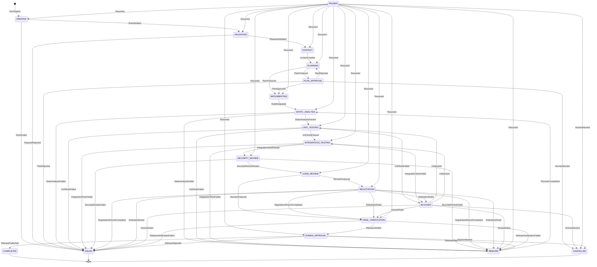

# Orchestrator state machine

<!-- GENERATED by `msa fsm diagram --output docs/fsm.md`. Do not edit by hand. -->

Generated from the transition table in `src/msa/core/transitions.py`. A contract
test fails if this page and the table disagree. The design rationale is in
[ADR-015](adr/015-aegis-architecture.md).

## Rules

Each rule names the phases its handler may move to. The dispatcher rejects any other
target at runtime.

| From | Event | May move to |
|---|---|---|
| `CREATED` | `RunAdmitted` | `VALIDATING` |
| `CREATED` | `RunDenied` | `FAILED` |
| `VALIDATING` | `RequestValidated` | `CONTEXT` |
| `VALIDATING` | `RequestRejected` | `FAILED` |
| `CONTEXT` | `ContextLoaded` | `PLANNING` |
| `PLANNING` | `PlanProduced` | `PLAN_APPROVAL`, `IMPLEMENTING` |
| `PLAN_APPROVAL` | `PlanApproved` | `IMPLEMENTING` |
| `PLAN_APPROVAL` | `PlanRejected` | `PLANNING`, `FAILED` |
| `PLAN_APPROVAL` | `HumanAborted` | `CANCELLED` |
| `IMPLEMENTING` | `ImplementationCompleted` | `IMPLEMENTING` |
| `IMPLEMENTING` | `AcceptanceTestsAuthored` | `IMPLEMENTING` |
| `IMPLEMENTING` | `BuildIntegrated` | `STATIC_ANALYSIS` |
| `STATIC_ANALYSIS` | `StaticAnalysisPassed` | `UNIT_TESTING` |
| `STATIC_ANALYSIS` | `StaticAnalysisFailed` | `REWORK`, `FAILED` |
| `UNIT_TESTING` | `UnitTestsPassed` | `INTEGRATION_TESTING` |
| `UNIT_TESTING` | `UnitTestsFailed` | `REWORK`, `BLOCKED`, `FAILED` |
| `INTEGRATION_TESTING` | `IntegrationTestsPassed` | `SECURITY_REVIEW` |
| `INTEGRATION_TESTING` | `IntegrationTestsFailed` | `REWORK`, `BLOCKED`, `FAILED` |
| `SECURITY_REVIEW` | `SecurityReviewPassed` | `CODE_REVIEW` |
| `SECURITY_REVIEW` | `SecurityReviewFailed` | `REWORK`, `FAILED` |
| `CODE_REVIEW` | `ReviewProduced` | `NEGOTIATION`, `FINAL_VERIFICATION` |
| `NEGOTIATION` | `NegotiationRoundCompleted` | `NEGOTIATION`, `REWORK`, `FINAL_VERIFICATION`, `FAILED` |
| `NEGOTIATION` | `ArbitrationRuled` | `REWORK`, `FINAL_VERIFICATION`, `BLOCKED`, `FAILED` |
| `BLOCKED` | `HumanRuled` | `REWORK`, `FINAL_VERIFICATION`, `FAILED` |
| `BLOCKED` | `Unblocked` | `UNIT_TESTING`, `INTEGRATION_TESTING` |
| `BLOCKED` | `HumanAborted` | `CANCELLED` |
| `PAUSED` | `Resumed` | `CREATED`, `VALIDATING`, `CONTEXT`, `PLANNING`, `IMPLEMENTING`, `STATIC_ANALYSIS`, `UNIT_TESTING`, `INTEGRATION_TESTING`, `SECURITY_REVIEW`, `CODE_REVIEW`, `NEGOTIATION`, `REWORK`, `FINAL_VERIFICATION`, `HUMAN_APPROVAL` |
| `PAUSED` | `HumanAborted` | `CANCELLED` |
| `REWORK` | `RevisionCompleted` | `STATIC_ANALYSIS` |
| `FINAL_VERIFICATION` | `ReleaseVerified` | `HUMAN_APPROVAL` |
| `FINAL_VERIFICATION` | `ReleaseVerificationFailed` | `REWORK`, `FAILED` |
| `HUMAN_APPROVAL` | `ReleaseApproved` | `HUMAN_APPROVAL` |
| `HUMAN_APPROVAL` | `ReleaseRejected` | `REWORK`, `FAILED` |
| `HUMAN_APPROVAL` | `HumanAborted` | `CANCELLED` |
| `HUMAN_APPROVAL` | `ReleasePublished` | `COMPLETED` |

## Global escapes

These apply in every non-terminal phase, ahead of the rules. A terminal run cancels
its pending effects and publishes its outcome.

| Event | To | Why |
|---|---|---|
| `CancelRequested` | `CANCELLED` | operator cancellation |
| `PauseRequested` | `PAUSED` | an operator pauses (not while a person is being asked) |
| `DeadlineExceeded` | `FAILED` | wall-clock limit (also any event stamped after it) |
| `AgentFailed` | `FAILED` | agent invocation failed after gateway retries |
| `AgentRefused` | `FAILED` | model and every fallback declined |
| `EffectFailed` | `FAILED` | a non-LLM effect's executor failed |
| `(budget)` | `FAILED` | spend overcommits the ledger, or the next effect is unfundable |
