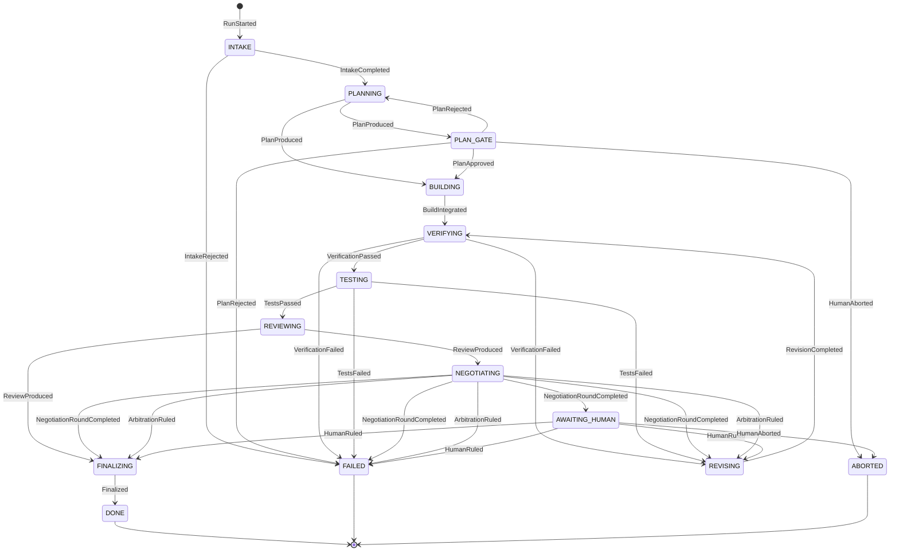

# Orchestrator state machine

<!-- GENERATED by `msa fsm diagram --output docs/fsm.md`. Do not edit by hand. -->

Generated from the transition table in `src/msa/core/transitions.py`. A contract
test fails if this page and the table disagree. The design rationale is in
[PLAN.md §2](PLAN.md#2-the-state-machine).

## Rules

Each rule names the phases its handler may move to. The dispatcher rejects any other
target at runtime.

| From | Event | May move to |
|---|---|---|
| `INTAKE` | `IntakeCompleted` | `PLANNING` |
| `INTAKE` | `IntakeRejected` | `FAILED` |
| `PLANNING` | `PlanProduced` | `PLAN_GATE`, `BUILDING` |
| `PLAN_GATE` | `PlanApproved` | `BUILDING` |
| `PLAN_GATE` | `PlanRejected` | `PLANNING`, `FAILED` |
| `PLAN_GATE` | `HumanAborted` | `ABORTED` |
| `BUILDING` | `ImplementationCompleted` | `BUILDING` |
| `BUILDING` | `AcceptanceTestsAuthored` | `BUILDING` |
| `BUILDING` | `BuildIntegrated` | `VERIFYING` |
| `VERIFYING` | `VerificationPassed` | `TESTING` |
| `VERIFYING` | `VerificationFailed` | `REVISING`, `FAILED` |
| `TESTING` | `TestsPassed` | `REVIEWING` |
| `TESTING` | `TestsFailed` | `REVISING`, `FAILED` |
| `REVIEWING` | `ReviewProduced` | `NEGOTIATING`, `FINALIZING` |
| `NEGOTIATING` | `NegotiationRoundCompleted` | `NEGOTIATING`, `AWAITING_HUMAN`, `REVISING`, `FINALIZING`, `FAILED` |
| `NEGOTIATING` | `ArbitrationRuled` | `REVISING`, `FINALIZING`, `FAILED` |
| `AWAITING_HUMAN` | `HumanRuled` | `REVISING`, `FINALIZING`, `FAILED` |
| `AWAITING_HUMAN` | `HumanAborted` | `ABORTED` |
| `REVISING` | `RevisionCompleted` | `VERIFYING` |
| `FINALIZING` | `Finalized` | `DONE` |

## Global escapes

These apply in every non-terminal phase, ahead of the rules. A terminal run cancels
its pending effects and publishes its outcome.

| Event | To | Why |
|---|---|---|
| `CancelRequested` | `ABORTED` | operator cancellation |
| `DeadlineExceeded` | `FAILED` | wall-clock limit (also any event stamped after it) |
| `AgentFailed` | `FAILED` | agent invocation failed after gateway retries |
| `AgentRefused` | `FAILED` | model and every fallback declined |
| `EffectFailed` | `FAILED` | a non-LLM effect's executor failed |
| `(budget)` | `FAILED` | spend overcommits the ledger, or the next effect is unfundable |
